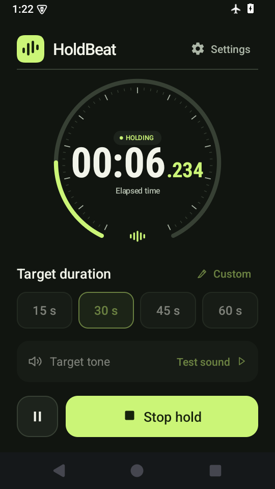
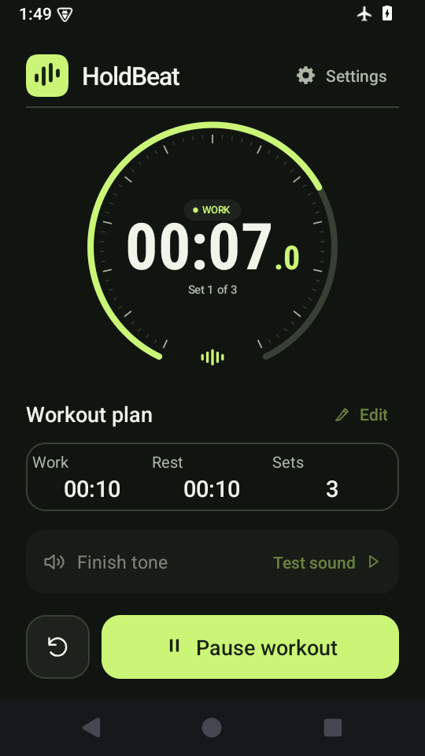
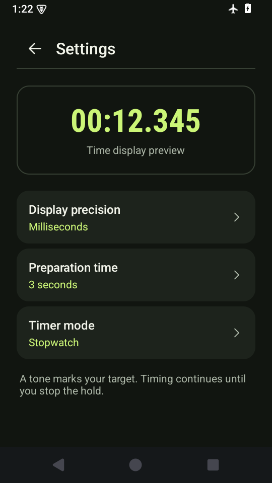

# HoldBeat

HoldBeat is an Android timer for planks, wall sits, and other static holds. Set a target, get into position, and listen for the cue. The tone uses your phone’s alarm volume and works with the screen locked.

[Download the APK](https://github.com/hacker-niki/HoldBeat/releases/latest/download/HoldBeat.apk) · [Русская версия](README.ru.md)

<p>
  
  
  
</p>

## During a hold

- **Countdown** ends the hold with a three-note chime. Start with a preset of 15, 30, 45, or 60 seconds, or set your own time from 1 second to 99 minutes 59 seconds.
- **Stopwatch** counts up, sounds once at the target, and keeps going. Tap **Stop hold** to see how long you held the position.
- **Sets** alternates exercise and rest automatically. Choose **Settings → Timer mode → Sets**, then edit the plan on the timer screen. For example, three 30-second holds with 15 seconds of rest take two minutes. Each work interval starts with a short tone, a lower double tone signals rest, and a three-note chime ends the last set. Set rest to zero for consecutive holds.
- **Preparation time** gives you 3, 5, or 10 seconds to get into position. A short start tone marks the beginning of the hold. Preparation is off by default.
- **Display precision** lets you choose whole seconds, tenths, hundredths, or milliseconds. The settings screen previews the format. The dial refreshes at the screen’s cadence.
- **Keep screen on** is enabled by default while HoldBeat is visible. Turn it off in Settings to use your phone’s usual screen timeout.

Use **Test sound** to check the volume before starting. The app remembers your duration and settings. The interface follows the device language and supports English and Russian.

## Install

Open the release APK on a phone running Android 8.0 or later. Android may ask you to allow installation from the app you used to open the file. On Android 12 and 12L, grant alarms and reminders access if prompted.

The public APK has a dedicated release signature. If you installed the earlier **Tone Chronometer** debug build, remove it before installing this first public release. Removing it clears its saved timer.

## Build from source

Use JDK 17 or 21 and Android SDK Platform 35. From the repository root, run

```sh
./gradlew :app:assembleDebug :app:lintDebug
```

The installable development build is written to `app/build/outputs/apk/debug/app-debug.apk`.

For the end-to-end smoke test, install the debug APK on a dedicated English-language Android emulator. The test clears the app’s data and checks settings persistence, countdowns, and interval transitions with the screen locked, including a two-second rest across process restarts. Run `python3 tools/smoke_test.py emulator-5554` with your emulator’s serial.

## Project history

HoldBeat is a standalone project. Its [archived fork](https://github.com/hacker-niki/HoldBeat-fork-archive) grew out of [antoniom/Millisecond-Chronometer](https://github.com/antoniom/Millisecond-Chronometer). The original Android widget, Eclipse project and their authors’ commit history remain on [master](https://github.com/hacker-niki/HoldBeat/tree/master). [Browse the original files](legacy/README.md). The current app is in [app/](app/). Both are available under the [Apache License 2.0](LICENSE).
