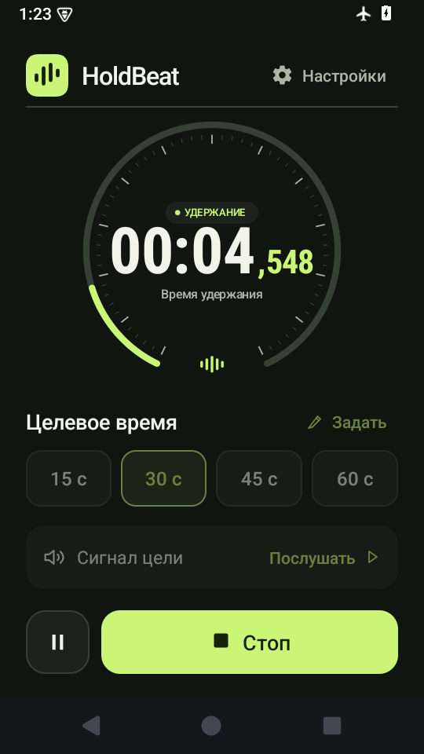
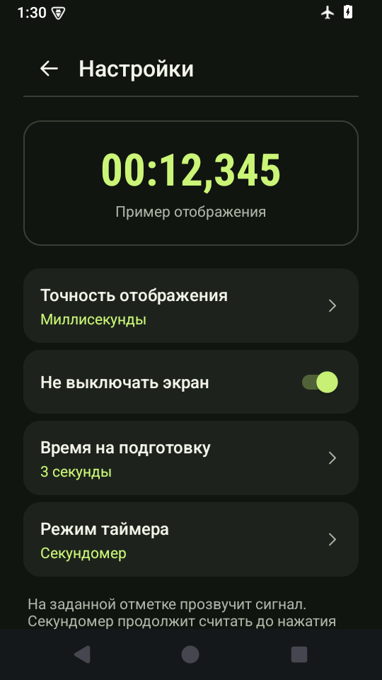

# HoldBeat

Таймер для планки, «стульчика» у стены и других статических упражнений. Задайте время, примите положение и дождитесь сигнала. Он использует громкость будильника и работает при заблокированном экране.

[Скачать APK](https://github.com/hacker-niki/HoldBeat/releases/latest/download/HoldBeat.apk) · [English](README.md)

<p>
  
  
</p>

## Во время тренировки

- **Обратный отсчёт.** Выберите 15, 30, 45 или 60 секунд либо задайте своё время от секунды до 99 минут 59 секунд. В конце прозвучат три ноты.
- **Секундомер.** Например, поставьте цель в 30 секунд. Услышав сигнал, можете продолжать держать планку. Нажмите **Стоп**, чтобы увидеть фактическое время.
- **Подготовка.** Дайте себе 3, 5 или 10 секунд, чтобы занять положение. Начало подхода отмечает отдельный короткий звук. По умолчанию подготовка выключена.
- **Точность.** В настройках доступны целые секунды, десятые, сотые и миллисекунды. Там же видно, как будет выглядеть время. Цифры обновляются в такт экрану.
- **Не выключать экран.** По умолчанию экран остаётся включённым, пока открыт HoldBeat. Если отключить эту настройку, экран будет гаснуть через обычное для телефона время.

Перед подходом нажмите **Послушать**, чтобы проверить громкость. Приложение запоминает длительность и настройки. Язык выбирается по языку телефона. Доступны русский и английский.

## Установка

Откройте APK на телефоне с Android 8.0 или новее. Если Android запросит разрешение на установку из этого источника, разрешите её для приложения, в котором открыли файл. На Android 12 и 12L при необходимости разрешите будильники и напоминания.

У публичной версии собственная подпись. Если уже установлена тестовая сборка **Tone Chronometer**, перед первым публичным релизом её потребуется удалить. При удалении сбросятся сохранённые параметры таймера.

## Сборка

Понадобятся JDK 17 или 21 и Android SDK Platform 35. В корне репозитория выполните

```sh
./gradlew :app:assembleDebug :app:lintDebug
```

Путь к тестовому APK — `app/build/outputs/apk/debug/app-debug.apk`.

Для сквозной проверки установите тестовый APK на отдельный эмулятор Android с английским интерфейсом. Тест сбрасывает данные HoldBeat, проверяет подготовку и достижение цели с заблокированным экраном, а также сохранение настроек. Запустите `python3 tools/smoke_test.py emulator-5554`, подставив серийный номер эмулятора.

## История

Репозиторий начинался как форк [antoniom/Millisecond-Chronometer](https://github.com/antoniom/Millisecond-Chronometer). Исходный виджет, проект Eclipse и история коммитов их авторов сохранены в ветке [master](https://github.com/hacker-niki/HoldBeat/tree/master). [Посмотреть исходники](legacy/README.md). Код HoldBeat находится в [app/](app/). Лицензия проекта — [Apache 2.0](LICENSE).
